<p align="center">
  
</p>

<h1 align="center">Drafty</h1>

<p align="center">
  <b>One tap. A reply that sounds like you.</b><br>
  AI replies for WhatsApp, Instagram, Messenger, SMS, email, comments and almost any other app or site.<br>
  It even answers for you when your phone is locked. Uses your own Claude or Gemini account, no API key.
</p>

<p align="center">
  <a href="https://github.com/Kshitiz726/Drafty/releases/latest/download/Drafty.apk">
    
  </a>
  &nbsp;
  <a href="https://github.com/Kshitiz726/Drafty/releases/latest">
    
  </a>
  &nbsp;
  
</p>

---

## Demo

<table>
  <tr>
    <td align="center" width="50%">
      <a href="docs/screenshots/demo-instagram-dm.mp4">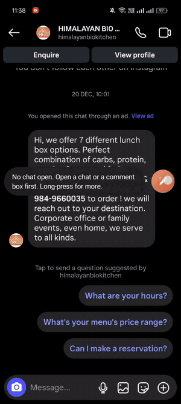</a><br>
      <b>Messages</b><br>
      <sub>Tap the button in an Instagram DM. Drafty reads the chat, writes the reply and sends it.</sub><br>
      <a href="docs/screenshots/demo-instagram-dm.mp4">▶ Watch full video</a>
    </td>
    <td align="center" width="50%">
      <a href="docs/screenshots/demo-instagram-comment.mp4"></a><br>
      <b>Comments</b><br>
      <sub>Tap in a reel's comment box. Drafty reads the comments and writes one that fits.</sub><br>
      <a href="docs/screenshots/demo-instagram-comment.mp4">▶ Watch full video</a>
    </td>
  </tr>
</table>

## Features

| | |
|---|---|
| **Tap to reply** | Open any chat and tap the floating Drafty button. The reply is written straight into the text box, in your style and language. Works in WhatsApp, Instagram, Messenger, Telegram, Signal, SMS, Gmail and most other apps. |
| **Reply when phone is locked** | New 1:1 messages are answered from their notification while your screen is off, using the whole conversation. Reply as you, say you're away, or send a fixed text. |
| **Comments** | Tap in a comment box on Instagram, Facebook, YouTube and others. Drafty reads the post and its comments and writes something that fits. Every comment is also copied, for apps that block typing in. |
| **Sounds like you** | Copies how you text: length, casing, emoji, slang, Hinglish or Nepali. Never mixes up your messages with theirs. No em dashes, no robotic filler. |
| **Long-press tools** | Regenerate, shorter, warmer, formal, translate, catch up, analyze a chat, reply ideas, and for posts: TL;DR, summarize comments, opinions, best comments, find and ask. |
| **Private** | Uses your own Claude or Gemini login. Screen text is read only when you tap, chat memory stays on your phone, and Drafty's chats can be fully deleted from your AI account. |

## Screenshots

**A real chat, start to finish**

<p align="center">
  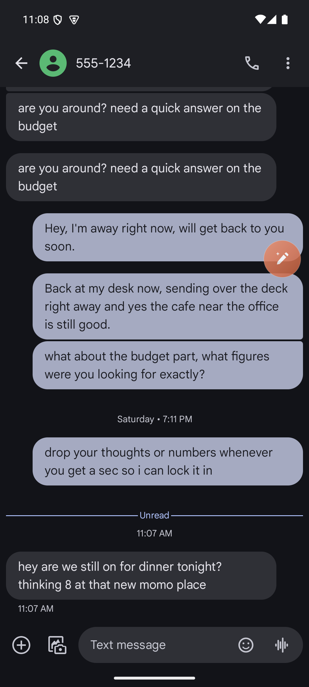&nbsp;
  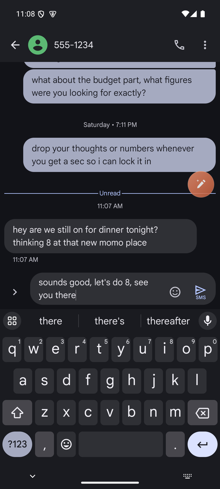&nbsp;
  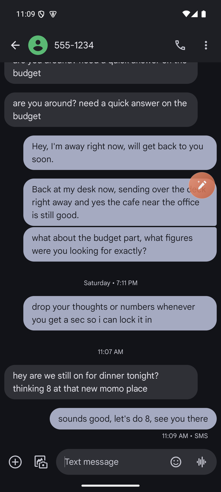
</p>
<p align="center"><sub>A message arrives &nbsp;→&nbsp; one tap writes the reply in your style &nbsp;→&nbsp; sent</sub></p>

**Tools**

<p align="center">
  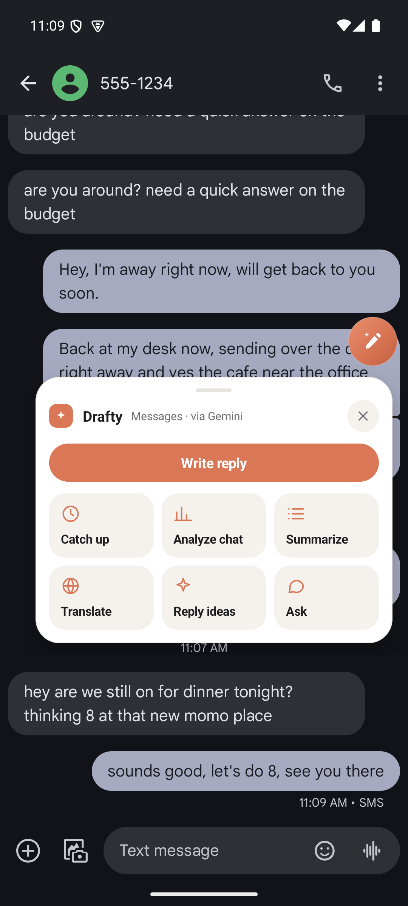&nbsp;
  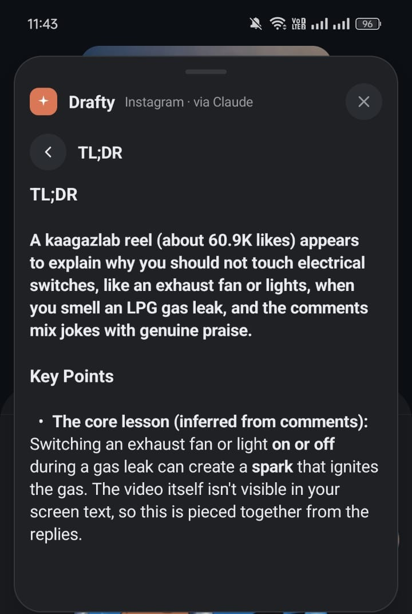
</p>
<p align="center"><sub>Long-press menu &nbsp;·&nbsp; TL;DR of an Instagram reel and its comments</sub></p>

**Settings**

<p align="center">
  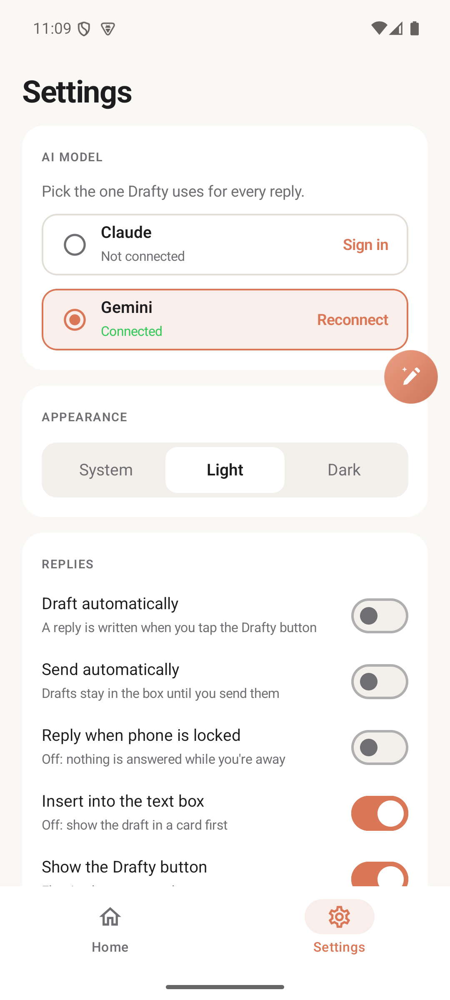&nbsp;
  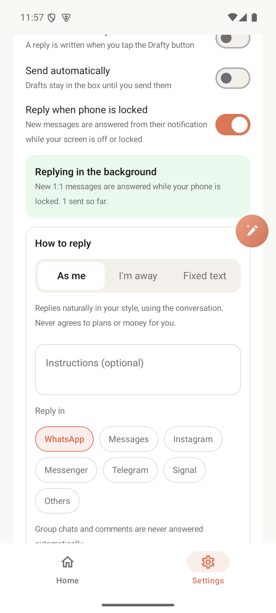&nbsp;
  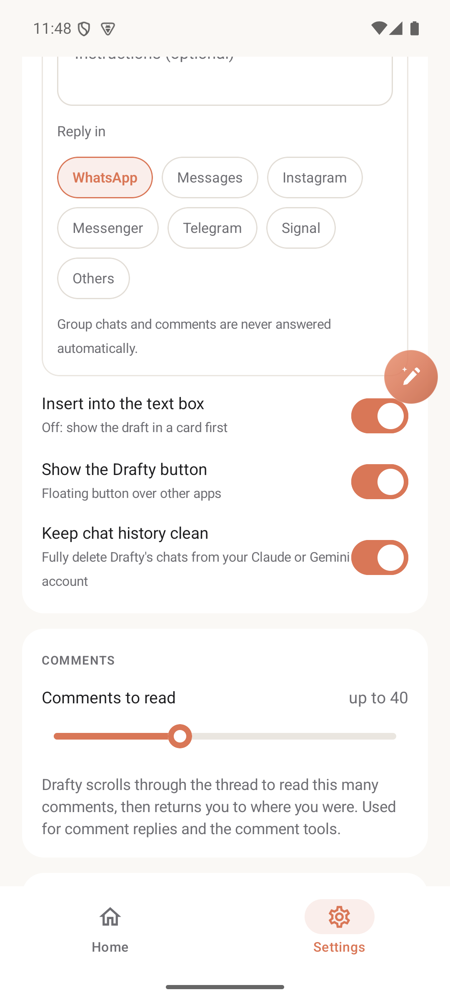&nbsp;
  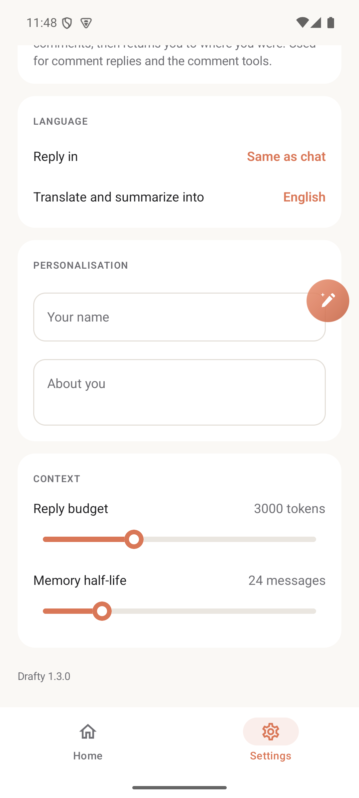
</p>
<p align="center"><sub>AI model and switches &nbsp;·&nbsp; Locked-phone replies &nbsp;·&nbsp; History and comments &nbsp;·&nbsp; Language and memory</sub></p>

**App and setup**

<p align="center">
  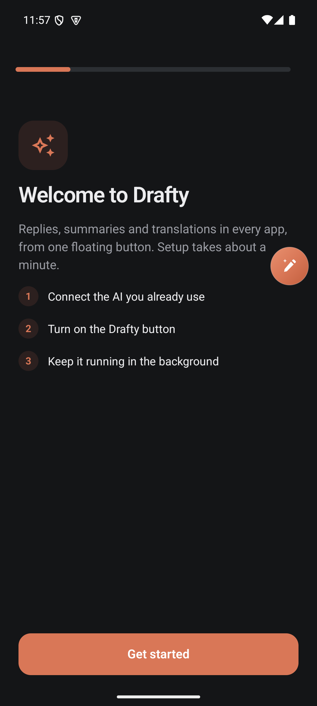&nbsp;
  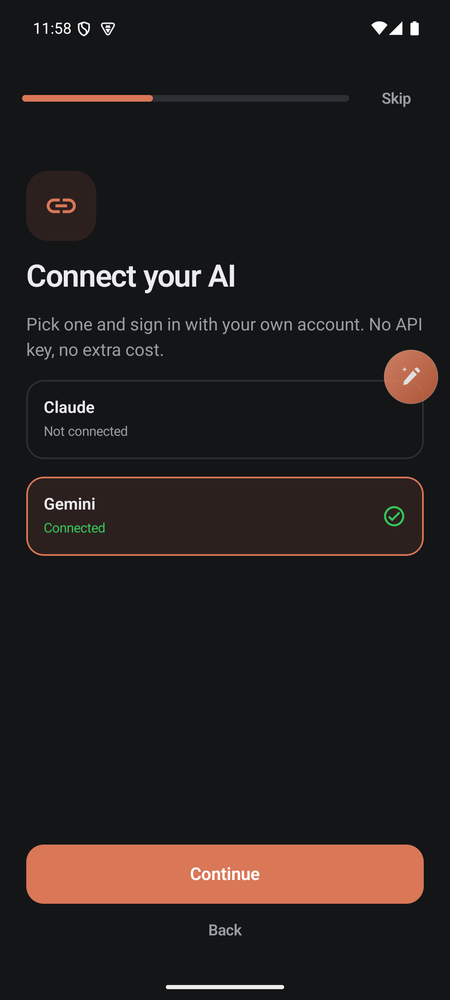&nbsp;
  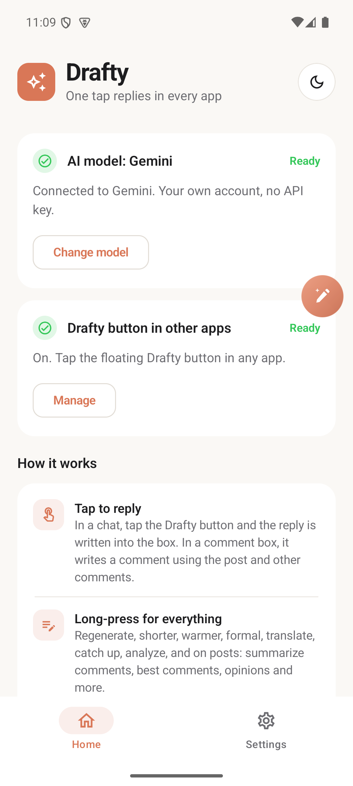&nbsp;
  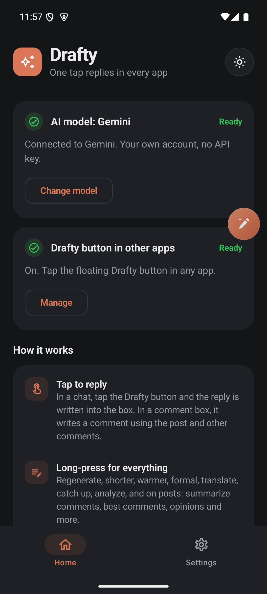
</p>
<p align="center"><sub>Guided setup &nbsp;·&nbsp; Connect Claude or Gemini &nbsp;·&nbsp; Home in light and dark</sub></p>

## Settings

| Setting | What it does |
|---|---|
| **AI model** | Claude or Gemini, signed in with your own account. |
| **Appearance** | System, Light or Dark. |
| **Draft automatically** | A reply appears as soon as you open a chat's reply box, without tapping. |
| **Send automatically** | After a draft is written in an open chat, Drafty sends it. |
| **Reply when phone is locked** | Answers new 1:1 messages while your screen is off or locked. Never while you're using the phone; group chats and comments are never answered. |
| &nbsp;&nbsp;↳ **How to reply** | **As me** (in your style, never agrees to plans or money for you), **I'm away**, or **Fixed text**. |
| &nbsp;&nbsp;↳ **Instructions** | Optional guidance, for example "keep it short" or "I'm at work until 6". |
| &nbsp;&nbsp;↳ **Reply in** | Pick the apps: WhatsApp, Messages, Instagram, Messenger, Telegram, Signal or others. |
| **Insert into the text box** | Off: shows the draft in a card first so you can review it. |
| **Show the Drafty button** | The floating button over other apps. Drag it anywhere. |
| **Keep chat history clean** | Fully deletes Drafty's chats, titles included, from your Claude or Gemini account. |
| **Comments to read** | How many comments Drafty scrolls through for comment replies and tools (5 to 100). |
| **Language** | Reply in the chat's language or a fixed one, and pick the language for translations and summaries. |
| **Personalisation** | Your name and a short note about you, used to sound more like you. |
| **Reply budget** | How much of the conversation is sent to the AI, in tokens. |
| **Memory half-life** | How far back Drafty looks in a chat (3 to 100 messages). Recent messages count most; older ones fade. |

## Install

**Android**
1. Tap **Download Android APK** above on your phone, open the file and allow installs from your browser if asked.
2. Open Drafty. The guided setup connects your AI, turns on the Drafty button and keeps it running in the background.

**Browser extension** (Chrome, Brave, Edge, Arc)
1. Download this repository (**Code → Download ZIP**) and unzip it.
2. Open `chrome://extensions`, turn on **Developer mode**, click **Load unpacked** and pick the folder.
3. Pick Claude or Gemini in the popup. Click into any message, email or comment box and press **Alt+R**. **Alt+A** opens the page assistant (TL;DR, summarize comments, ask anything).

## How it picks context

Each message is weighted by `w = 2^(-age / h) · 0.35^(gaps over 3h)`, where `h` is the memory half-life. Drafty sends the shortest recent stretch that holds 95% of the total weight, always including messages you haven't answered, within the reply budget. Comments are ranked by thread distance and likes.

## Notes

- Drafty uses each AI's own web app with your login. These are not official APIs and may change. Usage counts toward your plan.
- Drafty needs Accessibility access to read the chat you're in and type the reply, and Notification access only for replies while your phone is locked.

## Build from source

```bash
cd android
./gradlew assembleRelease
```

Requires JDK 17 and the Android SDK (API 35).
